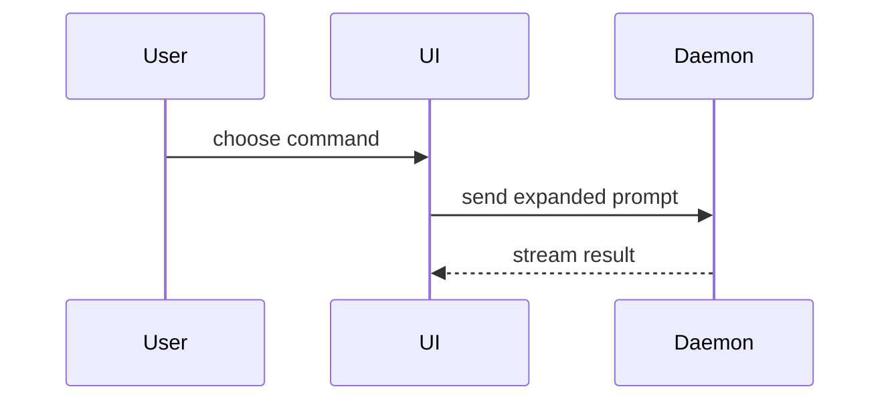

<!-- CUSTOM-BEGIN: keep-closes, reason: reshaping a body must not drop closing keywords (standalone implement-spec overwrites); retirement: delete markers if upstream handles existing bodies -->Closing keywords (`Closes #N`, `Fixes #N`), from the PR's existing body or supplied by the caller, go on their own lines after the template; add or remove only when asked (implement-spec step 3 landed-closes governs inside that skill).<!-- CUSTOM-END -->

Use this template for writing the PR body<!-- CUSTOM-BEGIN: strip-markers, reason: CUSTOM marker comments inside the template would be copied into PR bodies; retirement: delete markers if upstream template has no local fences --> (omit the CUSTOM marker comments)<!-- CUSTOM-END -->:

```markdown
## Summary

<diagram, diff-sketch, or tree>

## Evidence

- **Before:** <screenshot/output/failing test run>
  **After:** <screenshot/output/passing test run>
<!-- CUSTOM-BEGIN: corrections-line, reason: upstream template has no corrections line; retirement: delete markers if upstream adds it -->- Corrections: <n> (<link to log, or `none` if zero>)<!-- CUSTOM-END -->

## Merge Danger

**Door:** <one-way or two-way>

<optional: description>

<!-- CUSTOM-BEGIN: scope-line, reason: scope line renames upstream wording; retirement: delete markers if upstream adopts this wording -->**Scope:** <one sentence on what could feel this merge><!-- CUSTOM-END -->

<optional: potential ramifications of merge>

<!-- CUSTOM-BEGIN: blast-gate-template, reason: HTML-comment gate never renders so never fires; retirement: delete markers if upstream makes the gate visible -->
**Blast-radius:** [ ] skipped (<reason>) / [ ] ran (<one-line summary: Fact + verdict; never a local .scratch path>)
<!-- CUSTOM-END -->
```

## Sections

Skip all preambles and keep prose brief. Use the user's domain language from `GLOSSARY.md`.

### Summary

Pick the smallest view that makes the key point clear.

- Show logic or an algorithm as pseudocode:

```text
on(save)
  if content is unchanged
    return cached result
  write new content
  return fresh result
```

- Show runtime control flow as a call tree:

```text
submitForm
  createSession
    persistPrompt
    launchAgent
  navigateToSession
```

- Show UI structure as a component tree, including state and module boundaries that matter:

```text
<SessionPage> (apps/example/src/routes/session.tsx)
  useSessionEvents()
  <SessionToolbar>
    <RunSkillButton> (packages/ui)
```

- Show file responsibility or a broad refactor as a shallow file tree:

```text
src/
├── commands/       # parses user actions
├── sessions/       # owns session state
└── transport/      # sends API requests
```

- Show component interaction, control flow, or data flow with Mermaid:



- Use `diff` when the point is what changes and the surrounding shape already exists. Match the diff shape to the topic.

For a component change:

```diff
 <SessionPage>
   useSessionEvents()
   <SessionToolbar>
+    <RunSkillButton />
   <SessionTimeline>
+    <SkillResultCard />
```

For a file-layout change:

```diff
 src/
 ├── commands/
+│   └── show-me.ts       # expands the show-me command
 ├── sessions/
-└── transport.ts
+└── transport/
+    ├── client.ts
+    └── stream.ts
```

For a call-tree or call-stack change:

```diff
 submitForm
   createSession
     persistPrompt
+    expandSkillMention
     launchAgent
-  navigateToSession
+  navigateToSession
+    subscribeToEvents
```

For a state or control-flow change:

```diff
 on(save)
-  write content
+  if content is unchanged
+    return cached result
+  write new content
+  invalidate cache
```

- Show the whole block when most of it is new, when omitted context would hide ownership or order, or when the user needs a copyable target shape:

```ts
function expandSkill(command: string): string {
  const skillName = command.slice(1);
  return `use the ${skillName} skill`;
}
```

#### Guidance

Place each visual next to the short text it supports. Keep only the calls, files, props, states, and boundaries needed to answer the user's current question or the options to resolve the current discussion point.

You may use one of these, you may use several, it is unlikely you will use all of them. Use your judgement and don't overwhelm the user.

### Evidence

Concrete evidence that the change works. Show a before and after.

Screenshots are S-tier - when the environment is set up for it and the change is visual.

Execution-based evidence is A-tier. Test results, console output. Show the exact test that now fails and passes, using pseudocode.

### Merge Danger

Describe whether it's a one-way or two-way door. You can walk back through two-way doors, but not one-way doors. A PR that is cheap to roll back is lower risk. Changes that involve destructive actions or hard-to-reverse decisions are one-way doors.

Scope is one sentence on the potential impact of this PR. Consider all possibilities. Examples are layout shift, breakages for consumers, mobile responsiveness, etc. <!-- CUSTOM-BEGIN: blast-gate-pointer, reason: HTML-comment gate never renders so never fires; retirement: delete markers if upstream makes the gate visible -->For causal breakage analysis beyond this sentence (shared code / library version / concurrency-lifecycle / wire format), call the blast-radius skill when its Escalation rule fires (a big or wide change goes to an arena only as its step 6 routes it); always record the Blast-radius line so skipping stays a conscious act. That line records the outcome only; details live in the blast-radius writeup.<!-- CUSTOM-END -->
